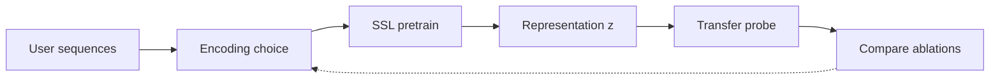
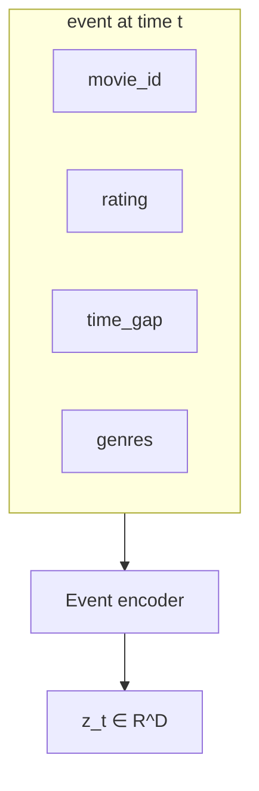
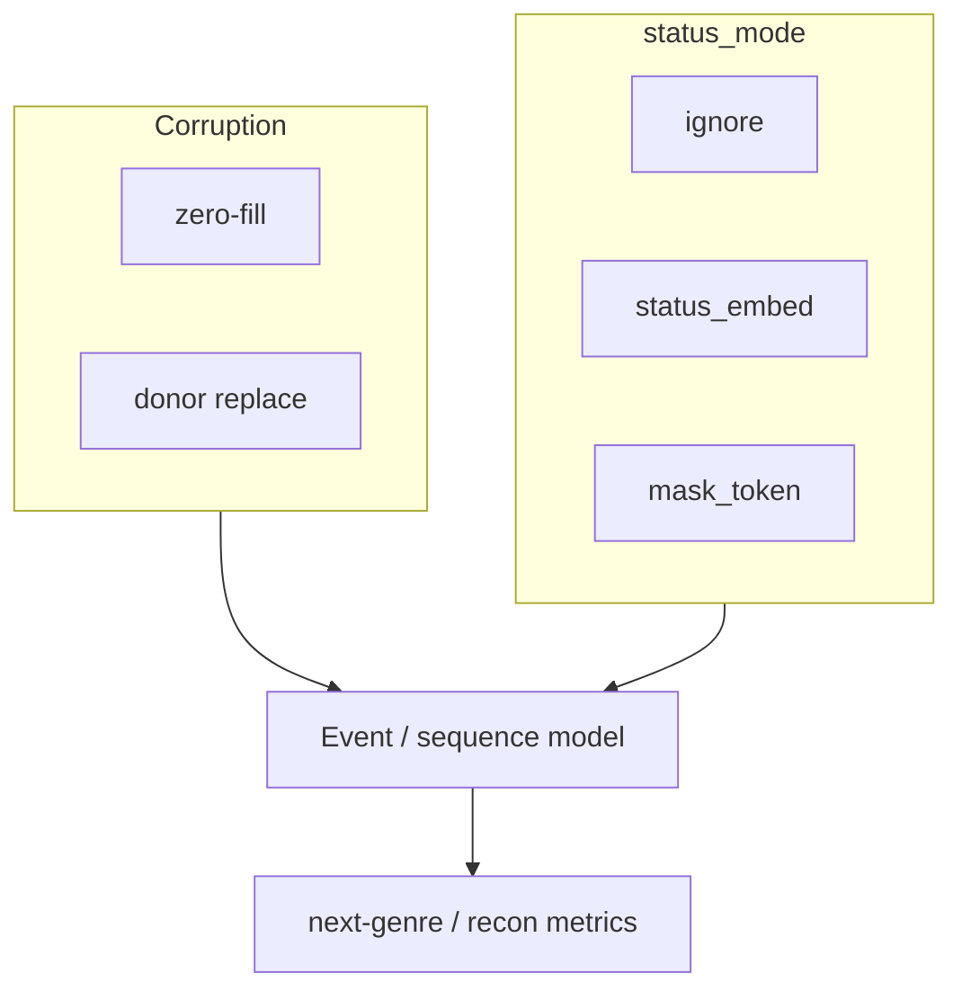
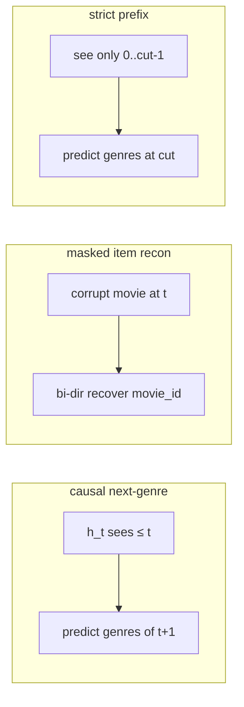
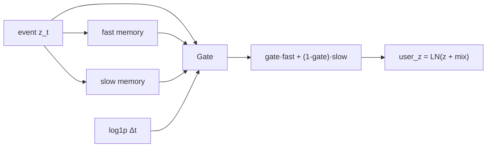
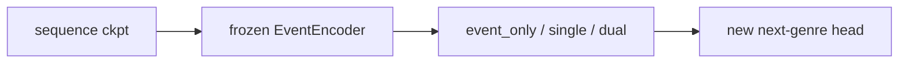

# behavioral-fm

A research scaffold for **behavioral foundation models**: how to encode user interaction histories so pretrained representations transfer to downstream tasks.

The goal is not a single best architecture. It is to **compare encoding choices** under controlled ablations — what information is visible, how missingness is signaled, how sequences are mixed over time — and measure whether those choices produce useful foundation-model representations.

**Testbed.** MovieLens-1M user rating sequences. Each interaction is a multi-field event (`movie_id`, `rating`, `time_gap`, `genres`).

**What we vary.**

- **Field / mask encoding** — how the event encoder represents corrupted or missing fields: no status signal (`ignore`), a learned status embedding (`status_embed`), or MAE-style mask tokens (`mask_token`).
- **Corruption mechanism** — zero-fill vs VIME-style donor replacement (and whether the encoder is told which fields were corrupted).
- **Temporal encoding** — per-event models; exponential decay memory (single / dual timescale); sequence transformer with causal next-step, bidirectional masked reconstruction, and strict-prefix objectives.
- **Transfer probes** — e.g. next-genre prediction, so representation quality is judged beyond reconstruction loss alone.

**Current scope.** Data pipeline, corruption + event encoder, four pretrain ablations with a linear/MLP probe loop, sequence pretraining (`scripts/train_behavioral_sequence.py`), and temporal user-state transfer (`scripts/train_behavioral_state.py` + `temporal_state.py` / `behavioral_state_model.py`). Fuller downstream eval is still ahead.

### Research loop



Vary the encoder / corruption / temporal mixing at **B**, keep data and probes fixed, then rank which encodings transfer.

### Multi-field event

Each timestep is a structured event, not a single token:



### Encoding ablations

Two knobs on top of the same events — **how** fields are hidden, and **whether** the encoder is told:



| Name | Corruption | `status_mode` | Idea |
|------|------------|---------------|------|
| `zero` | zero-fill | `ignore` | Hide values only |
| `status` | zero-fill | `status_embed` | + learned observed/masked flag |
| `token` | zero-fill | `mask_token` | + MAE-style mask tokens |
| `vime` | donor | `ignore` | Swap in foreign values; hide the mask label |

### Temporal objectives

Once events are encoded, the sequence model tests different ways to mix time:



### Temporal user state

Separately from the transformer, `DecayMemory` maintains a causal running state that blends each real event with \(e^{-\Delta t / \tau}\). `BehavioralStateModel` wraps the event encoder + one of these backbones + a seeded next-genre head (same head init across treatments via `fork_rng`):

| `backbone` | Module | Idea |
|------------|--------|------|
| `event_only` | `EventOnlyState` | No memory; mask padding in `z` |
| `single` | `SingleTimescaleState` | One decay bank (default \(\tau=24\)h) residual into `z` |
| `dual` | `DualTimescaleState` | Fast (~2h) + slow (~30d) banks; MLP gate mixes them |



### Transfer protocol (sequence → temporal state)

1. Train a sequence model (`train_behavioral_sequence.py`). Example: `--objective causal --experiment zero` → `status_mode=ignore`. The `p0.15` in the filename records `--mask-probability`; causal training does not apply corruption.
2. Day-10 / state training loads **only** `event_encoder.*` from that checkpoint (transformer + heads discarded), freezes the encoder, and trains `event_only` / `single` / `dual` + a new next-genre head (`train_behavioral_state.py`).



---

## Status

| Area | Status | Notes |
|------|--------|-------|
| MovieLens download & inspect | ✅ Done | `scripts/download_data.py`, `scripts/inspect_data.py` |
| Per-user sequence prep | ✅ Done | Chronological sequences → `data/processed/` |
| Dataset + pad collate | ✅ Done | `src/data/movielens.py` |
| Field corruption (zero / donor) | ✅ Done | `src/objectives/corruption.py` |
| Event encoder (base) | ✅ Done | Per-event field fusion |
| Status modes + recon heads | ✅ Done | `ignore` / `status_embed` / `mask_token` + mask heads in `MaskedEventModel` |
| Reconstruction decoder | ✅ Done | `--decoder linear|mlp` (default `mlp` residual trunk; probe still uses encoder `z`) |
| Pretrain losses + train loop | ✅ Done | `scripts/pretrain.py` (4 ablation modes) + `scripts/compare.py` |
| Smoke / unit checks | ✅ Done | `scripts/smoke_test.py`, `scripts/test.py`, `tests/test_temporal_state.py` |
| Sequence backbone + train | ✅ Done | `BehavioralSequenceModel` + `scripts/train_behavioral_sequence.py` |
| Decay memory user state | ✅ Done | `DecayMemory` + `event_only` / `single` / `dual` in `temporal_state.py` |
| Behavioral state model + train | ✅ Done | `behavioral_state_model.py` + `scripts/train_behavioral_state.py` |
| Downstream eval | ⬜ Not started | Beyond next-genre linear probe |
| Configs | ✅ Done | `src/config/experiment_modes.py` (re-exported from `configs/`) |

### Results

**Event-level SSL** (`--max-steps 3000`, `--decoder mlp`; Exp 4 in [EXPERIMENTS.md](EXPERIMENTS.md)):

| mode | val_objective ↓ | val_mask_accuracy | next_genre_probe_micro_ap ↑ | embedding_mean_dim_std | effective_rank |
|------|----------------:|------------------:|----------------------------:|-----------------------:|---------------:|
| `zero` | **7.7867** | — | 0.3339 | 0.0765 | **24.10** |
| `status` | 7.7958 | — | 0.3329 | 0.0762 | 18.01 |
| `token` | 7.7990 | — | **0.3347** | 0.0757 | 22.18 |
| `vime` | 8.1114 | 0.7497 | 0.3158 | 0.0550 | 7.30 |

**Temporal state transfer** (frozen encoder from `causal_zero_p0.15`, 3 epochs, next-genre `micro_ap`; constant baseline ≈ 0.276):

| backbone | seed 7 | seed 17 | seed 27 |
|----------|-------:|--------:|--------:|
| `event_only` | 0.253 | 0.246 | 0.217 |
| `single` (τ=24h) | 0.289 | 0.276 | 0.271 |
| `dual` (2h / 720h) | **0.298** | **0.284** | **0.279** |

Mechanism checks (seed 7): equal-τ dual 0.298 · fixed half-gate 0.294 · learnable τ 0.299. Artifacts are local under `artifacts/` (gitignored).

---

## Quick start

```bash
# Use the project env (has torch, etc.)
.behavior-fm/bin/python scripts/download_data.py
.behavior-fm/bin/python scripts/prepare_sequences.py

# Event-level SSL ablations (writes artifacts/day06_<mode>_*)
.behavior-fm/bin/python scripts/pretrain.py --mode zero --max-steps 3000
.behavior-fm/bin/python scripts/compare.py
.behavior-fm/bin/python scripts/bootstrap.py --prefix day06_mlp

# Sequence pretrain → frozen encoder for temporal-state transfer
SPLIT=artifacts/day10/split.json
.behavior-fm/bin/python -m scripts.train_behavioral_sequence \
  --objective causal --experiment zero --mask-probability 0.15 \
  --epochs 3 --probe-epochs 3 --split-file "$SPLIT" --create-split

# Temporal-state ablations (loads only EventEncoder weights)
EVENT_CKPT=artifacts/day08/causal_zero_p0.15.pt
.behavior-fm/bin/python -m scripts.train_behavioral_state --backbone dual \
  --run-id dual2_720_main --seed 7 --epochs 3 --split-file "$SPLIT" \
  --event-checkpoint "$EVENT_CKPT" --freeze-event-encoder

# Unit tests for decay memory / dual gate
.behavior-fm/bin/python -m pytest tests/test_temporal_state.py -v
```

