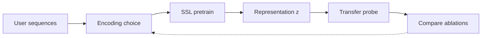
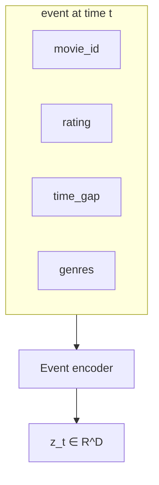
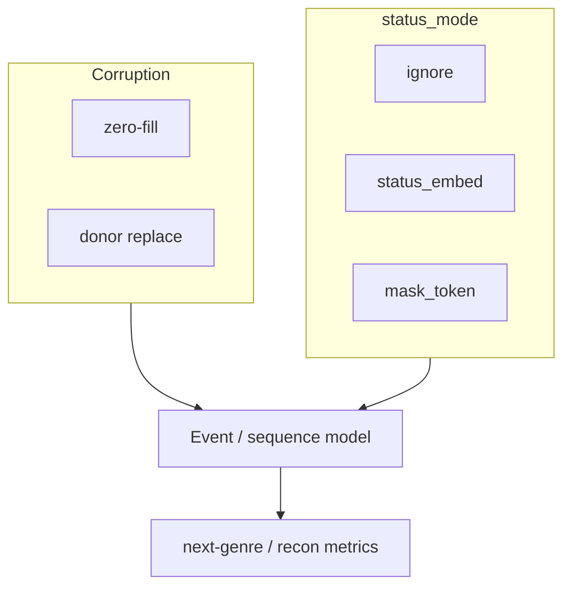
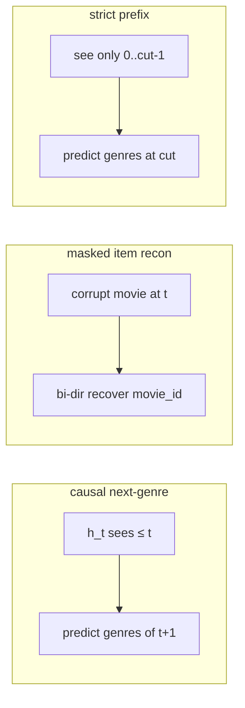

# behavioral-fm

A research scaffold for **behavioral foundation models**: how to encode user interaction histories so pretrained representations transfer to downstream tasks.

The goal is not a single best architecture. It is to **compare encoding choices** under controlled ablations — what information is visible, how missingness is signaled, how sequences are mixed over time — and measure whether those choices produce useful foundation-model representations.

**Testbed.** MovieLens-1M user rating sequences. Each interaction is a multi-field event (`movie_id`, `rating`, `time_gap`, `genres`).

**What we vary.**

- **Field / mask encoding** — how the event encoder represents corrupted or missing fields: no status signal (`ignore`), a learned status embedding (`status_embed`), or MAE-style mask tokens (`mask_token`).
- **Corruption mechanism** — zero-fill vs VIME-style donor replacement (and whether the encoder is told which fields were corrupted).
- **Temporal encoding** — per-event models vs a sequence transformer with causal next-step, bidirectional masked reconstruction, and strict-prefix objectives.
- **Transfer probes** — e.g. next-genre prediction, so representation quality is judged beyond reconstruction loss alone.

**Current scope.** Data pipeline, corruption + event encoder, four pretrain ablations with a linear/MLP probe loop, and an early sequence backbone (`src/models/sequence.py`, `src/objectives/sequence_tasks.py`). Fuller downstream eval and longer temporal runs are still ahead.

### Research loop



Vary the encoder / corruption / temporal mixing at **B**, keep data and probes fixed, then rank which encodings transfer.

### Multi-field event

Each timestep is a structured event, not a single token:



### Encoding ablations

Two knobs on top of the same events — **how** fields are hidden, and **whether** the encoder is told:



| Name | Corruption | `status_mode` | Idea |
|------|------------|---------------|------|
| `zero` | zero-fill | `ignore` | Hide values only |
| `status` | zero-fill | `status_embed` | + learned observed/masked flag |
| `token` | zero-fill | `mask_token` | + MAE-style mask tokens |
| `vime` | donor | `ignore` | Swap in foreign values; hide the mask label |

### Temporal objectives

Once events are encoded, the sequence model tests different ways to mix time:



---

## Status

| Area | Status | Notes |
|------|--------|-------|
| MovieLens download & inspect | ✅ Done | `scripts/download_data.py`, `scripts/inspect_data.py` |
| Per-user sequence prep | ✅ Done | Chronological sequences → `data/processed/` |
| Dataset + pad collate | ✅ Done | `src/data/movielens.py` |
| Field corruption (zero / donor) | ✅ Done | `src/objectives/corruption.py` |
| Event encoder (base) | ✅ Done | Per-event field fusion |
| Status modes + recon heads | ✅ Done | `ignore` / `status_embed` / `mask_token` + mask heads in `MaskedEventModel` |
| Reconstruction decoder | ✅ Done | `--decoder linear|mlp` (default `mlp` residual trunk; probe still uses encoder `z`) |
| Pretrain losses + train loop | ✅ Done | `scripts/pretrain.py` (4 ablation modes) + `scripts/compare.py` |
| Smoke / unit checks | ✅ Done | `scripts/smoke_test.py`, `scripts/test.py` |
| Temporal backbone over events | 🟡 In progress | `BehavioralSequenceModel` + causal / masked-item / strict-prefix losses |
| Downstream eval | ⬜ Not started | Beyond next-genre linear probe |
| Configs | 🟡 In progress | `configs/experiment_modes.py` (ablation specs) |

### Results

Latest: `--max-steps 3000` with `--decoder mlp` (Exp 4 in [EXPERIMENTS.md](EXPERIMENTS.md)):

| mode | val_objective ↓ | val_mask_accuracy | next_genre_probe_micro_ap ↑ | embedding_mean_dim_std | effective_rank |
|------|----------------:|------------------:|----------------------------:|-----------------------:|---------------:|
| `zero` | **7.7867** | — | 0.3339 | 0.0765 | **24.10** |
| `status` | 7.7958 | — | 0.3329 | 0.0762 | 18.01 |
| `token` | 7.7990 | — | **0.3347** | 0.0757 | 22.18 |
| `vime` | 8.1114 | 0.7497 | 0.3158 | 0.0550 | 7.30 |

Lower `val_objective` is better for reconstruction; higher `next_genre_probe_micro_ap` is better for transfer. `val_mask_accuracy` only applies to VIME.

Compared with the earlier linear-head run @ 3000 steps, the MLP decoder raises effective rank (VIME 1.57→7.30) and VIME probe AP (0.284→0.316), while MAE probe scores stay ~0.33–0.335. Full history: [EXPERIMENTS.md](EXPERIMENTS.md).

---

## Quick start

```bash
# Use the project env (has torch, etc.)
.behavior-fm/bin/python scripts/download_data.py
.behavior-fm/bin/python scripts/prepare_sequences.py

# Pretrain one ablation (writes artifacts/day06_<mode>_*)
# Default --decoder mlp (richer); use --decoder linear for the old heads-only baseline.
.behavior-fm/bin/python scripts/pretrain.py --mode zero --max-steps 3000
.behavior-fm/bin/python scripts/pretrain.py --mode status --max-steps 3000
.behavior-fm/bin/python scripts/pretrain.py --mode token --max-steps 3000
.behavior-fm/bin/python scripts/pretrain.py --mode vime --max-steps 3000

# Print a metrics table across modes
.behavior-fm/bin/python scripts/compare.py

# Bootstrap uncertainty on probe AP (all four modes)
.behavior-fm/bin/python scripts/bootstrap.py --prefix day06_mlp
```

